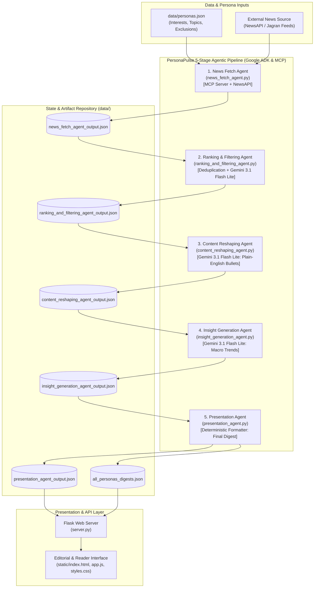

# PersonaPulse

> **Enterprise Agentic News Personalization & Publishing Pipeline**

PersonaPulse is an enterprise agentic system designed to integrate with Jagran's existing content and publishing ecosystem, taking over the repetitive work of news discovery, filtering, and rewriting so each reader receives a ready-to-read, personalized feed instead of a generic article list.

---

## 📑 Architecture Overview

PersonaPulse replaces manual editorial curating with an autonomous, multi-agent pipeline orchestrated through **Google Agent Development Kit (ADK)** and the **Model Context Protocol (MCP)**. Each agent is responsible for a single, well-defined cognitive or deterministic task. Intermediate states are serialized as structured JSON artifacts, guaranteeing full auditability, modular testing, and deterministic replayability.



---

## 📂 Project Structure & Folder Tasks

The repository is organized into distinct functional domains, cleanly decoupling autonomous agent logic, persistent state data, backend routing, and client-side presentation:

```
persona-pulse/
├── agents/             # Autonomous agent implementations & pipeline orchestrator
│   ├── data/           # Local agent workspace artifacts & step outputs
│   ├── news_fetch_agent.py
│   ├── ranking_and_filtering_agent.py
│   ├── content_reshaping_agent.py
│   ├── insight_generation_agent.py
│   ├── presentation_agent.py
│   ├── pipeline.py
│   └── test_all_personas.py
├── data/               # Centralized persona profiles & pipeline JSON outputs
│   ├── personas.json
│   ├── news_fetch_agent_output.json
│   ├── ranking_and_filtering_agent_output.json
│   ├── content_reshaping_agent_output.json
│   ├── insight_generation_agent_output.json
│   ├── presentation_agent_output.json
│   └── all_personas_digests.json
├── static/             # Interactive frontend application & visual dashboard
│   ├── index.html
│   ├── styles.css
│   └── app.js
├── server.py           # REST API server & static client hosting
├── requirements.txt    # Project dependencies (Google ADK, MCP, Flask, Requests)
└── .env                # API keys and environment configuration
```

### Folder Responsibilities

#### `agents/` — Autonomous Agent Intelligence Layer
The core computational engine of PersonaPulse. Contains all five Google ADK agents, the Model Context Protocol (MCP) server implementation, the asynchronous pipeline orchestrator, and multi-persona testing harnesses. Each agent is isolated into its own file with a dedicated responsibility, eliminating monolithic complexity and allowing independent optimization and prompt engineering.

#### `data/` — Knowledge Base & Pipeline State Store
Acts as the persistence and inspection hub for the system. Contains the static persona configuration (`personas.json`) and captures snapshots of the output generated by each agent at each step of the pipeline. This guarantees editorial transparency: publishing teams can inspect exactly why an article was selected, how it was rewritten, and how the weekly insight was derived.

#### `static/` — Editorial & Reader Frontend Dashboard
Houses the responsive single-page web interface (`index.html`, `styles.css`, `app.js`). Serves as an interactive showroom for Jagran's editorial teams and end-users, enabling persona switching, real-time pipeline execution visualization, inspection of intermediate agent outputs, article bookmarking, and reader feedback (like/skip signals).

---

## 🤖 Deep Dive: Agents Folder (`agents/`)

Every file inside the `agents/` directory fulfills a specific operational contract in the news transformation lifecycle.

### 1. `news_fetch_agent.py` — News Retrieval & MCP Server
* **Role**: Primary discovery and ingest gateway.
* **Core Technologies**: Model Context Protocol (MCP) SDK, NewsAPI REST client, Google ADK `LlmAgent`.
* **Primary Responsibilities**:
  * Exposes an MCP Server (`PersonaPulse-NewsFetch-Server`) with standard tools, resources, and prompts.
  * Ingests target persona profiles containing monitored topics and exclusion keywords.
  * Queries NewsAPI's `/everything` endpoint for stories published in the rolling 7-day window.
  * Applies an initial deterministic keyword exclusion filter (e.g., dropping celebrity gossip for professional personas).
  * MCP Resources: Exposes `personas://list` (active persona definitions) and `news://latest` (latest raw articles).
  * MCP Tools: Provides `fetch_news_for_topics` and `fetch_persona_news` for agentic tool use.
  * Persists retrieved raw items into `data/news_fetch_agent_output.json`.

### 2. `ranking_and_filtering_agent.py` — Curated Ranking & Deduplication
* **Role**: Editorial quality control and persona relevance curation.
* **Core Technologies**: Google ADK `LlmAgent`, `gemini-3.1-flash-lite`, Deterministic Title/URL hash set matching.
* **Primary Responsibilities**:
  * **Deduplication Tool**: Normalizes titles and URLs to eliminate syndicated cross-posts and duplicate wire feeds before LLM scoring.
  * **Relevance Reasoning**: Submits remaining articles to `gemini-3.1-flash-lite` with persona instructions to score editorial fit.
  * **Top-10 Selection**: Filters high-noise backlogs down to the top 10 most informative, high-impact stories aligned with the reader's professional or personal focus.
  * Persists ranked articles to `data/ranking_and_filtering_agent_output.json`.

### 3. `content_reshaping_agent.py` — Plain-Language Transformation
* **Role**: News rewriting and cognitive load reduction.
* **Core Technologies**: Google ADK `LlmAgent`, `gemini-3.1-flash-lite`.
* **Primary Responsibilities**:
  * Reads the titles, descriptions, and sources of the top 10 ranked stories.
  * Rewrites each article into 3 to 5 concise, high-clarity bullet points written in plain English.
  * Strips editorial fluff, sensationalism, and repetitive boilerplate while preserving key factual takeaways, figures, and context.
  * Ensures that readers can scan entire complex news pieces in under 30 seconds.
  * Persists formatted bullet points to `data/content_reshaping_agent_output.json`.

### 4. `insight_generation_agent.py` — Macro Trend & Synthesis Generation
* **Role**: Holistic theme identification and executive briefing.
* **Core Technologies**: Google ADK `LlmAgent`, `gemini-3.1-flash-lite`.
* **Primary Responsibilities**:
  * Examines the collective set of reshaped bullet points across all selected articles as an integrated corpus.
  * Identifies overarching market trends, policy shifts, structural movements, or recurring themes connecting seemingly disparate stories.
  * Synthesizes a focused 3-to-4 sentence weekly trend briefing tailored to the persona's perspective (e.g., highlighting AI deployment impact for tech professionals or monetary policy shifts for finance enthusiasts).
  * Persists the synthesized insight paragraph to `data/insight_generation_agent_output.json`.

### 5. `presentation_agent.py` — Clean Packaging & Output Normalization
* **Role**: Client delivery packaging and schema enforcement.
* **Core Technologies**: Deterministic Python (Zero-LLM overhead for high performance and reliability).
* **Primary Responsibilities**:
  * Consolidates the outputs of the previous agents into a finalized, uniform contract for the frontend.
  * Constructs the final digest object comprising persona metadata, generation timestamp, the synthesized weekly insight summary, and a cleaned array of articles.
  * Normalizes article schemas (`title`, `url`, `source`, `published_at`, `bullet_points`) and injects interactive client placeholders (`feedback: null`).
  * Persists the completed digest to `data/presentation_agent_output.json`.

### 6. `pipeline.py` — End-to-End Async Pipeline Orchestrator
* **Role**: Pipeline supervisor, session manager, and batch processor.
* **Core Technologies**: Google ADK `InMemoryRunner`, Python `asyncio`, JSON sanitizers.
* **Primary Responsibilities**:
  * Manages the strict sequential execution order:
    `News Fetch` ➔ `Ranking & Filtering` ➔ `Content Reshaping` ➔ `Insight Generation` ➔ `Presentation`.
  * Runs each ADK agent in isolated sessions via `InMemoryRunner`, passing state downstream through structured prompts.
  * Robust JSON extraction (`extract_json`) ensuring clean parsing of LLM outputs across markdown fences and escaping quirks.
  * Updates intermediate JSON files in `data/` at every milestone to ensure live tracking and step-by-step progress reporting.
  * Provides CLI support for single-persona execution (`python pipeline.py tech_professional`) and batch processing (`python pipeline.py all`) generating `data/all_personas_digests.json`.

### 7. `test_all_personas.py` — Comprehensive Multi-Persona Test Harness
* **Role**: Regression testing, pipeline verification, and matrix benchmarking.
* **Core Technologies**: Python `asyncio`, JSON reporting, automated execution grid.
* **Primary Responsibilities**:
  * Dynamically queries all persona profiles registered in `data/personas.json`.
  * Iteratively triggers the full 5-agent pipeline for each persona under clean conditions.
  * Validates schema integrity, article counts, and insight presence for each profile.
  * Generates an **Agent Test Matrix Results** summary in the terminal indicating execution status, article count, and error diagnostics.

---

## 🌐 Application Server & API Interface (`server.py`)

The root `server.py` file exposes a lightweight, CORS-enabled Flask API that connects the agentic pipeline to Jagran's web publishing frontends.

| Endpoint | Method | Description |
|---|---|---|
| `/` | `GET` | Serves the PersonaPulse interactive web dashboard. |
| `/api/personas` | `GET` | Returns all available persona configurations from `data/personas.json`. |
| `/api/personas` | `POST` | Allows dynamic creation of new user personas with custom topic weights and exclusion rules. |
| `/api/digest/<persona_id>` | `GET` | Retrieves the cached pre-generated digest for the specified persona. |
| `/api/pipeline/run/<persona_id>` | `POST` | Triggers a live, end-to-end execution of the 5-agent pipeline for the selected persona. |
| `/api/pipeline/steps` | `GET` | Returns intermediate JSON artifacts across all 5 agents for deep inspection. |
| `/api/feedback` | `POST` | Captures reader feedback (likes, skips, comments) to drive downstream model and ranking refinement. |

---

## 🎯 Configured Personas (`data/personas.json`)

PersonaPulse includes built-in configurations that model distinct Jagran reader segments:

* **Tech Professional**
  * *Topics*: Technology, Software, AI, Startups
  * *Exclusions*: Celebrity, Gossip
* **Student**
  * *Topics*: Education, Scholarships, Career, Exams
  * *Exclusions*: Stock Market, Finance
* **Finance Enthusiast**
  * *Topics*: Stock Market, Economy, Investing, Banking
  * *Exclusions*: Sports
* **Sports Fan**
  * *Topics*: Cricket, Football, Olympics, Sports
  * *Exclusions*: Politics

---

## 🏢 Enterprise Value for Jagran

* **Editorial Productivity**: Automates the hours spent daily on routine wire aggregation and basic bullet-point summarization, freeing editorial staff to focus on original investigative journalism and editorial commentary.
* **Reader Retention & Engagement**: Transforms traditional walls of text into high-velocity, bulleted briefings paired with macro weekly insights, boosting daily active engagement.
* **Modular Integration**: Built upon open standards (Google ADK, MCP, standard JSON contracts) allowing direct integration with existing CMS workflows, mobile apps, WhatsApp digests, or newsletter dispatchers.
